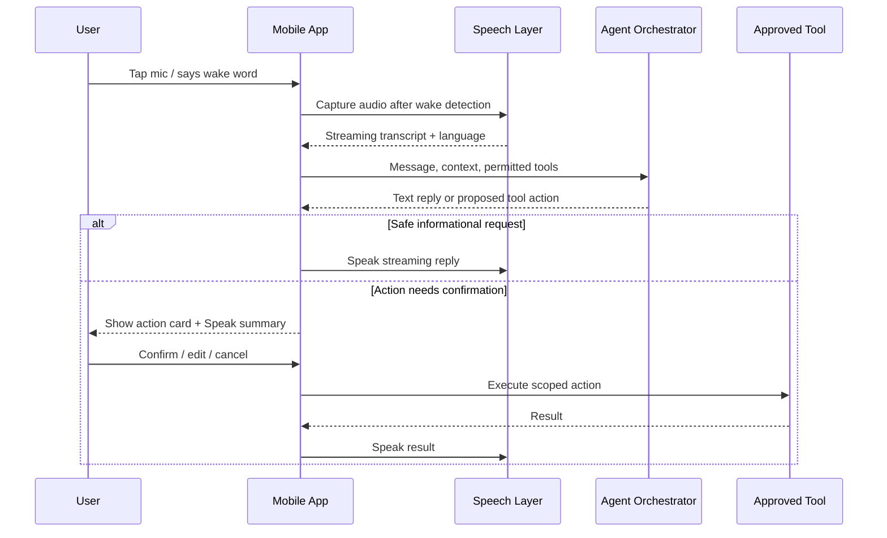
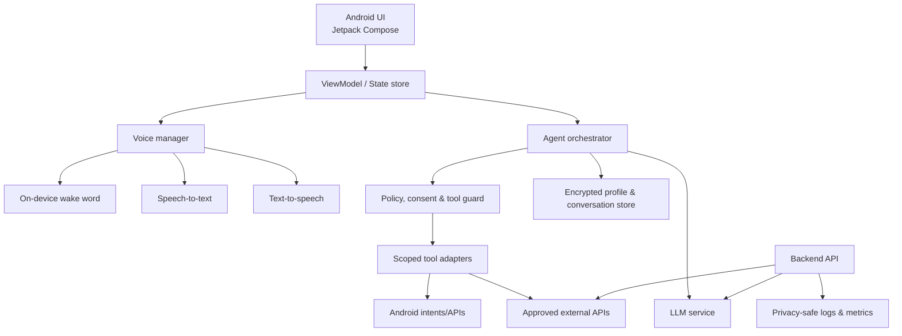
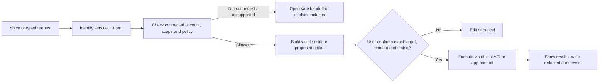

# Jarvis-जैसा Mobile AI Agent — Product & Build Blueprint

> **Goal:** Android-first personal AI agent जो naturally Hindi/Hinglish/English में बात करे, selected phone tasks को permission के साथ करे, और warm **male voice** में जवाब दे। Product की अपनी branding, wake word और personality रखें—Google Assistant/Alexa के names, voices या UI को copy न करें।

---

## 1. Product definition

### 1.1 One-line promise

**“बोलो, पूछो, और permission के साथ काम करवा लो—एक private, fast, Hindi-first phone companion.”**

### 1.2 MVP user stories

1. User कहे: “Hey Nova, कल 9 बजे Aman को call याद दिलाना,” और agent reminder बनाकर confirmation बोले।
2. User कहे: “आज बारिश होगी?” और agent location permission/selected city के आधार पर short spoken answer दे।
3. User कहे: “Mummy को WhatsApp करो: मैं 10 मिनट में आ रहा हूँ,” और send करने से पहले message preview + confirmation दिखाए।
4. User कहे: “सुबह 6 बजे alarm लगा दो,” और alarm create करे।
5. User कहे: “आज मेरे कितने meetings हैं?” और connected calendar से concise summary दे।

### 1.3 Explicit non-goals for v1

- No unrestricted phone control, background surveillance, banking/payment, or security-bypass actions.
- No sending messages, placing calls, deleting data, purchases, or smart-home changes without a visible confirmation step.
- No always-on cloud recording; wake-word audio should be processed locally where possible.

---

## 2. Experience principles

| Principle | Product decision |
| --- | --- |
| Fast first | Tap-to-talk response starts in under 1.5 seconds; stream answer as it is generated. |
| Voice is optional | Every voice action has text, controls, and accessible visual feedback. |
| Ask less, confirm smartly | Low-risk actions can execute immediately; high-impact actions require confirmation. |
| Private by default | Show what data/permission is needed, why it is needed, and provide a delete-history control. |
| Hindi-first, multilingual | Detect Hindi, Hinglish and English; keep names, dates, and commands reliable across languages. |
| Calm personality | Short, useful replies; no fake certainty; state when a tool or permission is unavailable. |

---

## 3. Information architecture

```text
Mobile App
├── Home / Assistant
│   ├── Tap-to-talk button
│   ├── Suggested actions
│   ├── Conversation transcript
│   └── Active task cards
├── Tasks
│   ├── Reminders & alarms
│   ├── Calendar briefing
│   └── Follow-ups
├── History
│   ├── Conversations
│   ├── Executed actions
│   └── Delete/export controls
├── Integrations
│   ├── Calendar
│   ├── Contacts / calling
│   ├── Messaging
│   ├── Weather/location
│   └── Smart home (post-MVP)
└── Settings
    ├── Voice & language
    ├── Wake word
    ├── Permissions
    ├── Privacy & memory
    ├── Notifications
    └── Account
```

---

## 4. Core conversation and action flow



### Intent routing rules

| Intent | Example | Handling |
| --- | --- | --- |
| Answer | “India ki capital?” | Answer directly; cite web source in UI when live search is used. |
| Device task | “6 बजे alarm” | Use Android alarm/reminder tool; show result. |
| Communication | “Rahul ko call karo” | Resolve contact, show target, require confirmation. |
| Personal data | “मेरी meetings” | Require integration consent; retrieve minimum required data. |
| Ambiguous | “उसे message कर दो” | Ask one short clarifying question. |
| Unsafe/unavailable | “Lock screen bypass करो” | Refuse clearly and offer safe alternatives. |

---

## 5. UI/UX design map

### 5.1 Visual direction

- **Theme:** dark graphite base with electric blue/cyan accent; optional light theme.
- **Brand motif:** a soft animated orb/waveform, not a copied assistant visual.
- **Typography:** large Hindi-capable font (for example, Noto Sans Devanagari) plus a readable Latin fallback.
- **Spacing:** 8-point grid, 16 px screen padding, touch targets at least 48 × 48 dp.
- **Motion:** waveform reacts to listening/thinking/speaking; respect the system reduced-motion preference.
- **Accessibility:** transcript always visible, semantic labels, high-contrast palette, dynamic type, haptics toggle.

### 5.2 Main screens

| Screen | Essential elements | Primary action |
| --- | --- | --- |
| Onboarding | Value proposition, language, voice preview, privacy explanation | Continue / skip optional integrations |
| Permission education | One permission at a time with purpose and “Not now” | Open system permission prompt |
| Home | Greeting, orb, mic, keyboard, suggestions, latest task | Start a request |
| Listening | Live waveform, partial transcript, cancel | Finish/cancel speaking |
| Response | Spoken text, sources where relevant, copy/share, follow-up chips | Continue conversation |
| Action confirmation | App/tool icon, exact payload, target and Cancel/Confirm | Confirm scoped action |
| Task detail | Status, edit/snooze/cancel | Manage reminder/alarm |
| Settings | Voice, language, privacy, integrations, permissions | Configure agent |

### 5.3 Home-screen wireframe

```text
┌─────────────────────────────────┐
│  Good evening, Arjun        ⚙️  │
│                                 │
│       ◌  (animated orb)         │
│     Tap and speak               │
│                                 │
│  [ 🎙 Ask Nova ] [ ⌨ Type ]      │
│                                 │
│  Try saying                      │
│  [Set an alarm] [Today's plan]  │
│  [Send a message] [Weather]     │
│                                 │
│  Upcoming                        │
│  • 6:00 AM — Gym alarm          │
└─────────────────────────────────┘
```

### 5.4 State design

| State | Orb color/motion | Text | Controls |
| --- | --- | --- | --- |
| Idle | Slow blue pulse | “Tap and speak” | Mic, keyboard |
| Listening | Responsive cyan waveform | Live transcript | Cancel |
| Thinking | Gentle rotating dots | “One moment…” | Stop |
| Speaking | Pulsing ring | Response transcript | Pause, stop, replay |
| Confirmation | Amber static ring | “Send this message?” | Confirm, edit, cancel |
| Error/offline | Muted gray | Actionable explanation | Retry, use text |

---

## 6. Feature roadmap

### Phase 0 — Discovery (1–2 weeks)

- Interview 8–12 target users (Hindi/Hinglish speakers) and test 20 common spoken commands.
- Define brand name, supported locales, privacy policy, tone, and risk categories.
- Validate Android OS/API constraints for each desired action before UI is finalized.

### Phase 1 — MVP (6–10 weeks)

- Tap-to-talk and typed chat.
- Hindi/Hinglish/English speech-to-text, streamed transcript, and male TTS voice selection.
- General Q&A, weather, alarms, timers, reminders, calendar read access.
- Contact lookup and draft-message flow; confirmation required before external actions.
- History, privacy controls, error handling, analytics with opt-in only.

### Phase 2 — Daily assistant (8–12 weeks)

- Wake word, offline fallback commands, proactive morning briefing.
- Calendar write access, notes/tasks, routines, contextual follow-ups.
- User-controlled memory: preferences, nicknames, frequent places.
- Wear OS / notification quick actions.

### Phase 3 — Ecosystem (after security review)

- Smart-home integrations through official provider APIs.
- Car/Android Auto-compatible, distraction-safe voice flows.
- Multi-device handoff and household profiles with strict account separation.

---

## 7. Technical architecture



### Recommended implementation choices

| Layer | Recommended starting choice | Notes |
| --- | --- | --- |
| App | Kotlin + Jetpack Compose | Android-first, modern UI and lifecycle support. |
| App architecture | Clean Architecture + MVVM; feature modules | Keep voice, agent, integrations and UI independently testable. |
| Local data | Room + Android Keystore encryption | Store minimum data; encrypt secrets and retained memory. |
| Networking | Retrofit/OkHttp + certificate pinning where appropriate | Never place long-lived provider secrets in the app. |
| Backend | TypeScript/NestJS or Python/FastAPI | Authentication, API proxying, tool policy and server-side orchestration. |
| Identity | OAuth 2.0 / OpenID Connect | Per-user tokens with revocation and least-privilege scopes. |
| Speech-to-text | Streaming multilingual STT; optional on-device model | Evaluate Hindi/Hinglish word error rate on real devices. |
| Text-to-speech | Licensed neural TTS with selectable male Hindi voice | Obtain provider voice/license consent; offer speed and voice preview. |
| LLM | Tool-calling model behind backend | Model only proposes actions; deterministic code validates and executes them. |
| Monitoring | Crash reporting + redacted structured events | Do not record raw audio/transcripts without explicit opt-in. |

### Module map

```text
app/
├── core/designsystem/       # theme, components, accessibility
├── core/network/            # authenticated API client
├── core/security/           # keystore, encryption, redaction
├── core/voice/              # wake word, STT, TTS interfaces
├── core/model/              # shared domain models
├── data/                    # repositories and local/remote sources
├── domain/                  # use cases and action policy
├── feature/onboarding/
├── feature/assistant/
├── feature/tasks/
├── feature/history/
├── feature/integrations/
├── feature/settings/
└── test/                    # unit, UI, integration, accessibility tests

backend/
├── api/                     # auth and request endpoints
├── agent/                   # prompt/context assembly and response streaming
├── policy/                  # risk classification and confirmation rules
├── tools/                   # calendar, weather, messaging adapters
├── memory/                  # consent-aware profile storage
├── providers/               # LLM/STT/TTS provider adapters
├── observability/           # redacted logs, metrics, audits
└── tests/
```

---

## 8. Voice, personality and language

### 8.1 Male voice specification

- Provide at least two **licensed male** voice options: “Warm Hindi” and “Neutral Hindi-English.”
- Onboarding includes a short voice preview, speech-rate slider, and “reply in Hindi / Hinglish / English” preference.
- Keep replies natural and short: answer first, then one useful detail. Avoid robotic filler.
- In noisy situations, show text and offer “repeat” instead of guessing silently.

### 8.2 Example response style

| User request | Voice response |
| --- | --- |
| “कल 7 बजे उठा देना” | “ठीक है, कल सुबह 7 बजे का alarm लगा दिया।” |
| “Delhi का मौसम?” | “दिल्ली में अभी 31 डिग्री है। शाम को बारिश की संभावना है—छाता ले जाना बेहतर रहेगा।” |
| “Riya को message भेज दो” | “मैं Riya को क्या भेजूँ? बोलकर बताइए या type कर दीजिए।” |
| “Message भेज दो: मैं पहुँच रहा हूँ” | “Riya को ‘मैं पहुँच रहा हूँ’ भेजना है। भेज दूँ?” |

### 8.3 System prompt behavior (conceptual)

1. Be helpful, concise, multilingual, and transparent about uncertainty.
2. Never claim an action happened until the tool returns success.
3. Propose structured tool calls only; never execute a sensitive action without the app’s policy/confirmation result.
4. Do not reveal secrets, infer sensitive attributes, or retain personal details without user consent.
5. When requests are ambiguous, ask one direct question in the user’s current language.

---

## 9. Permissions, privacy and safety

### 9.1 Permission strategy

| Permission/data | Ask only when | Alternative if declined |
| --- | --- | --- |
| Microphone | User taps mic or enables wake word | Typed input |
| Notifications | User creates reminders/tasks | In-app task list |
| Calendar | User connects calendar feature | Manual task creation |
| Contacts / phone | User asks to call or find a contact | Ask for typed number/name |
| Location | User asks location-based weather/navigation | City selection |
| Messaging | OS/provider-supported message action is requested | Draft/copy message; user sends manually |

### 9.2 Action risk policy

| Risk | Examples | Rule |
| --- | --- | --- |
| Low | Explain a fact, set local timer | Execute and report result. |
| Medium | Create reminder, read calendar summary | Confirm if details are unclear; show visible result. |
| High | Send message, call, delete/cancel item, smart lock | Always show exact target/payload and require explicit confirmation. |
| Prohibited | Bypass authentication, stalk/track, financial transfer without approved flow | Refuse and explain the safe boundary. |

### 9.3 Data lifecycle

- Audio is processed only for the active request unless the user explicitly opts into improvement recordings.
- Keep conversation history and memory **off by default** until the user enables them; provide per-item delete and “delete all.”
- Use a separate, revocable consent record for each connected service.
- Redact phone numbers, access tokens, message bodies, and exact location from operational logs.
- Create audit records for every external action: timestamp, tool, scope, confirmation, result—not raw private content.

---

## 10. API and tool contract

The model should never receive direct device privileges. It returns a typed proposal; the policy layer validates it against the user’s grants and the app executes only approved actions.

```json
{
  "tool": "create_reminder",
  "arguments": {
    "title": "Call Aman",
    "scheduled_at": "2026-09-13T09:00:00+05:30",
    "timezone": "Asia/Kolkata"
  },
  "risk": "medium",
  "requires_confirmation": false
}
```

For a message, require a confirmation token bound to the exact recipient and body, so a changed payload cannot reuse an earlier approval.

---

## 11. Delivery plan and definition of done

### Milestones

| Milestone | Deliverable | Exit criteria |
| --- | --- | --- |
| M1: Prototype | Clickable UI + scripted voice demo | Five task flows tested with users. |
| M2: Voice MVP | STT/TTS, chat, basic answers | Hindi/Hinglish transcription benchmark and latency target met. |
| M3: Trusted actions | Alarm, reminder, calendar read, message draft | Confirmation policy and audit log tests pass. |
| M4: Beta | Private Android beta | Crash-free sessions, consent UX, abuse testing, feedback loop. |
| M5: Launch | Store-ready release | Privacy policy, support flow, monitoring and rollback plan ready. |

### Quality gates

- **Latency:** measure p50/p95 from mic-stop to first transcript and first spoken token; set targets per chosen provider/device.
- **Reliability:** tool calls must be idempotent where possible; retry safely and never duplicate a sent action.
- **Voice quality:** test at least 100 Hindi/Hinglish commands across accents, noisy rooms, names and mixed English terms.
- **Security:** threat-model tokens, prompts, tools, logs and lost-device scenarios; perform penetration testing before public launch.
- **Accessibility:** test TalkBack, font scaling, contrast, touch targets and a fully text-only completion path.

---

## 12. First 30 days: practical checklist

### Week 1

- Select a working name (use “Nova” only as a placeholder), define target Android versions and write the privacy baseline.
- Rank the first 10 intents: alarm, timer, reminder, weather, calendar summary, call, message draft, note, search, navigation.
- Record real Hindi/Hinglish utterances for each intent and list failure cases.

### Week 2

- Create the Compose design system and interactive prototype for onboarding, home, listening, response and confirmation states.
- Run five usability sessions; fix confusing permission wording and confirmation behavior.

### Week 3

- Implement app shell, authentication, tap-to-talk, transcript, TTS, backend streaming and a safe mock tool layer.
- Add unit tests for intent schema validation and risk classification.

### Week 4

- Integrate alarm/reminder and weather first; then calendar read access.
- Add encrypted local storage, history deletion, observability redaction, error states and end-to-end tests.

---

## 13. Launch metrics

| Metric | Why it matters |
| --- | --- |
| Successful task completion rate | Core measure of agent usefulness. |
| Time to first response | Measures perceived speed. |
| Confirmation cancel/edit rate | Reveals incorrect interpretation before harm occurs. |
| Speech recognition correction rate | Identifies language/accent gaps. |
| 7-day retained users | Indicates daily utility. |
| Permission acceptance by feature | Shows whether permission value is clearly explained. |
| Privacy deletion success rate | Verifies user control works end to end. |

---

## 14. Recommended build order

1. **Design prototype and consent UX** before connecting models or device APIs.
2. Build **tap-to-talk + transcript + TTS**; do not start with always-on wake word.
3. Add **read-only answers**, weather, timers and reminders.
4. Add external actions with the **typed proposal → policy → confirmation → execution → audit** pipeline.
5. Add calendar, contact and messaging integrations one at a time, with user testing after each.
6. Only then evaluate wake word, memory, proactive features and smart-home controls.

This sequence produces a useful assistant early while keeping privacy, reliability and user trust ahead of “Jarvis-like” automation.

---

## 15. High-value additions to consider

These additions make the agent feel more personal and reliable without giving it unsafe, unrestricted phone control. Add them after the MVP is stable—not all at once.

| Addition | User value | Recommended phase | Safe implementation boundary |
| --- | --- | --- | --- |
| **Morning and evening briefings** | One spoken summary of weather, calendar, reminders and commute. | Phase 2 | User selects content, schedule and quiet hours; no unsolicited private-data sharing. |
| **Routines** | “Good morning” can start a controlled sequence such as weather + agenda + timer. | Phase 2 | Each routine contains approved, editable actions; high-risk steps still ask every time. |
| **Personal memory** | Remembers language, preferred name, common commute and reply style. | Phase 2 | Separate toggles per memory; show, edit and delete every item. Do not silently infer sensitive traits. |
| **Offline quick commands** | Timers, alarms, flashlight, volume and saved routines work with poor connectivity. | Phase 2 | Use a small on-device intent classifier and only allow a fixed command list. |
| **Document / image Q&A** | Ask “इस bill में total कितना है?” or summarize a selected PDF. | Phase 2 | User explicitly selects the file; process transiently and show extracted text before consequential use. |
| **Notification assistant** | Summarize selected notifications and prepare replies. | Phase 3 | Per-app opt-in; never auto-send and never read sensitive notifications aloud on a locked screen. |
| **Smart-home scenes** | “Movie mode” can adjust approved devices. | Phase 3 | Use official APIs; always confirm locks, cameras, security systems and purchases. |
| **Family / elder-care mode** | Larger controls, simple language, emergency contacts and medicine reminders. | Phase 3 | No medical diagnosis; make emergency actions explicit and configurable by the account owner. |
| **Car mode** | Large touch targets and short voice-first interactions while driving. | Phase 3 | Use Android Auto-compatible patterns; avoid visual tasks and long conversational responses. |

---

## 16. Personalization and memory design

### 16.1 Memory categories

| Category | Example | Default | User control |
| --- | --- | --- | --- |
| Profile | “Call me Arjun”; reply in Hinglish | Off until enabled | Edit/delete in Settings |
| Preference | “Male voice, 0.95× speed” | On-device setting | Change instantly |
| Routine | “Weekdays: briefing at 8 AM” | Off until created | Pause, edit, delete |
| Place | “Home” / “Office” for commute | Off until saved | Rename/delete; no continuous tracking |
| Temporary context | Current conversation topic | Session-only | Clears at session end unless saved |

### 16.2 Memory UX rules

1. When the agent proposes saving information, say exactly what will be saved and why: **“क्या मैं याद रखूँ कि आप Hinglish में जवाब पसंद करते हैं?”**
2. Show a small “Remembered” chip in the transcript whenever saved memory changes the response.
3. Include a one-tap command: **“जो तुमने मेरे बारे में याद रखा है, दिखाओ।”**
4. Support **“इसे भूल जाओ”** for the current item and **“सब memory delete करो”** in settings.
5. Never store passwords, OTPs, payment data, health diagnoses or private message content as memory.

---

## 17. Failure handling and fallback design

An assistant feels trustworthy when it explains failures clearly and leaves the user in control.

| Situation | App behavior | Spoken response example |
| --- | --- | --- |
| Speech is unclear | Highlight uncertain words; ask one focused question. | “मैं नाम ठीक से नहीं सुन पाया। क्या आप Rahul बोल रहे हैं या Rohan?” |
| No network | Run offline-safe intent if supported; otherwise preserve draft. | “Internet नहीं मिल रहा। मैंने आपका reminder draft save कर दिया है।” |
| Tool/API failure | Do not claim success; show retry and manual alternative. | “Message अभी भेजा नहीं जा सका। आप retry करें या text copy कर लें।” |
| Permission denied | Explain the value once and provide a non-permission path. | “Calendar access के बिना मैं meetings नहीं देख सकता, लेकिन आप event manually बना सकते हैं।” |
| Ambiguous time | Use the device timezone and state the interpreted date/time. | “आपका मतलब आज शाम 7 बजे है? Confirm कर दूँ?” |
| Unsafe request | Refuse succinctly, then suggest a safe option. | “मैं lock bypass नहीं कर सकता, लेकिन account recovery steps में मदद कर सकता हूँ।” |

### Degraded-mode order

1. On-device wake word / fixed offline command.
2. Cached user settings, alarms, timers and local reminders.
3. Typed request and queued draft when speech or network fails.
4. Cloud speech, model, retrieval and approved integrations when available.

---

## 18. Knowledge answers and source quality

For current facts (weather, news, prices, schedules), the app should retrieve data from approved providers instead of trusting a model’s memory.

```text
Question → classify: current or stable? → retrieve approved source if current
         → build concise answer → show source/time → speak answer
```

- Display a **source card**, publisher/provider, retrieval timestamp and “open source” link for live answers.
- Clearly say “मुझे पक्का नहीं है” when sources conflict or retrieval fails; do not fabricate citations.
- Use a separate, user-selected knowledge space for uploaded documents; do not mix organization/work documents with personal memory.
- Provide a **“Why this answer?”** control showing the selected sources and tool steps in simple language.

---

## 19. Cost, performance and reliability guardrails

| Area | Guardrail | Measurement |
| --- | --- | --- |
| Battery | Wake word must be opt-in and benchmarked on low/mid/high-end phones. | Battery use per hour of idle listening. |
| Data use | Compress/stream audio and show cellular-data option. | MB per voice request and monthly total. |
| Model cost | Summarize context, cap tool retries, cache safe answers briefly. | Cost per active user and per completed task. |
| Latency | Start speech output as answer streams; keep local actions local. | p50/p95 time to first transcript and first audio. |
| Reliability | Idempotency keys for actions; server-side retry only for safe operations. | Duplicate-action rate and tool success rate. |
| Provider outage | Provider abstraction plus status messaging and fallback modes. | Availability by STT, TTS, LLM and tool provider. |

### Pilot capacity plan

- Start with a **closed beta of 50–100 users** and instrument only redacted product events.
- Set per-user daily limits for expensive cloud voice/model work; explain the limit in the product rather than failing silently.
- Test on at least one low-end Android device, one mid-range device and one current flagship before expanding beta.
- Run load tests for simultaneous morning briefings, because scheduled usage creates predictable traffic spikes.

---

## 20. Test scenario catalog

Use these scripted checks before each beta release. Each scenario must verify visible transcript, spoken reply, action result and audit record where applicable.

| Area | Representative scenarios |
| --- | --- |
| Hindi/Hinglish STT | Hindi names, English app names, numbers, dates, regional accents, noisy room and slow speech. |
| Date/time | “कल”, “परसों”, “next Monday”, timezone changes, daylight-saving travel and recurring reminders. |
| Confirmation | Wrong contact, changed message body after approval, canceled action, expired confirmation token. |
| Permissions | First denial, permanent denial, permission revoked in Android settings, feature used without permission. |
| Connectivity | Airplane mode, network loss mid-stream, slow network, provider timeout and recovery. |
| Privacy | Delete one memory, delete all history, export data, reconnect integration, verify logs are redacted. |
| Accessibility | TalkBack navigation, 200% font size, reduced motion, text-only request and color contrast. |
| Security | Prompt injection in web/document content, malicious tool output, stolen session token and replayed action request. |

---

## 21. Decisions to make before development starts

1. **Platform scope:** Android-only MVP, or Android plus Wear OS from the start?
2. **Voice approach:** cloud neural male voice only, or a lower-quality offline fallback too?
3. **Data residency:** which country/region will store account data and optional conversation history?
4. **Primary user:** students, working professionals, families, or elder-care users? This changes the first 10 intents.
5. **Monetization:** free beta, freemium cloud quota, or subscription? Avoid ads that depend on private conversation data.
6. **Brand:** final wake word and name must be easy to pronounce in Hindi and English, distinctive, and legally cleared.

### Suggested MVP cut line

For the fastest high-quality first release, ship: **tap-to-talk, Hindi/Hinglish/English transcripts, selectable male TTS voice, timers, alarms, reminders, weather, calendar read, typed chat, and confirmation-based message drafts.** Defer always-on listening, unrestricted notification access, smart home, autonomous routines and persistent memory until the trust and safety foundations are proven.

---

## 22. App integrations, web search and automation

### 22.1 Integration principle

“Automation” should mean **a user-defined, permissioned workflow**, not silent control of third-party apps. Use official APIs where they support the required action; otherwise use Android’s share/deep-link/intents to prepare content and return the user to the target app. Do not automate through screen scraping, accessibility-service abuse, reverse-engineered/private APIs, stored passwords, or attempts to evade a platform’s rules.

Every connector must have its own consent page showing:

1. The exact account/data scope requested.
2. What the agent can read, draft, publish or send.
3. Whether the action will always need a final confirmation.
4. A one-tap disconnect control and data-deletion behavior.

### 22.2 Supported automation matrix

| Service | Useful voice commands | MVP-safe behavior | Later official integration path | Never do |
| --- | --- | --- | --- | --- |
| **WhatsApp** | “Aman को WhatsApp draft करो”, “Family group में यह photo share करो” | Resolve recipient only after user selection; open a prefilled draft/share flow; user reviews and sends. | Evaluate official business/provider options only if the product has a legitimate approved use case. | Auto-send personal messages, scrape chats, read private chats, or use unofficial automation libraries. |
| **Telegram** | “Telegram पर Riya को यह text भेजने के लिए draft खोलो”, “Channel update तैयार करो” | Create a draft/deep link or share sheet; visibly confirm recipient and text. | Bot/API connector for a user-owned bot, channel or group with scopes and admin consent. | Use a user account token as a bot, auto-DM strangers, or silently add/remove members. |
| **Instagram** | “इस photo का Instagram caption लिखो”, “Post के लिए draft बनाओ” | Generate caption/hashtags, preview the selected media, then hand off to the Instagram composer. | Use eligible official publishing/messaging capabilities after account-type, permission and review requirements are met. | Read DMs/feed without consent, bulk follow/like/comment, fake engagement, or bypass platform restrictions. |
| **Facebook** | “Facebook post का draft बनाओ”, “इस event का reminder set करो” | Create text/media draft and open a share/publish handoff; user performs final publish. | Official Page/authorized business tools for eligible pages with explicit role-based consent. | Post to a profile/page silently, harvest friend data, mass invite, or manipulate engagement. |
| **YouTube** | “YouTube पर Hindi AI videos खोजो”, “इस video का summary दो”, “My channel video upload draft बनाओ” | Search and present source/result cards; summarize only selected videos/transcripts where permitted; create title/description drafts. | Official channel upload/management integration with account consent and final publish confirmation. | Download/re-host copyrighted videos, inflate views/likes/subscribers, or publish without final review. |
| **Web search** | “Latest AI news खोजो”, “Best budget phone compare करो” | Search approved providers, show sources and dates, answer with citations and uncertainty. | Optional research mode with selected trusted domains and saved collections. | Present generated text as a verified source, hide sources, or execute purchases/forms from search results without confirmation. |

> **Important:** Platform capabilities, account eligibility, permissions and developer policies change. Validate each provider’s current official documentation, terms, security review and store-policy requirements before enabling a connector in production.

### 22.3 Universal external-action flow



### 22.4 Voice examples

| User says | Agent response / behavior |
| --- | --- |
| “WhatsApp पर Neha को लिखो कि मैं 10 मिनट late हूँ।” | “Neha के लिए message है: ‘मैं 10 मिनट late हूँ।’ मैं WhatsApp draft खोल रहा हूँ—भेजने से पहले आप review कर सकते हैं।” |
| “Instagram के लिए इस photo का caption बनाओ।” | “यह caption कैसा रहेगा? मैं photo के साथ Instagram composer खोल दूँ?” |
| “Telegram channel पर आज का update डाल दो।” | “मैं पहले update preview दिखाता हूँ। Channel **Tech Updates** पर publish करने के लिए आपकी final confirmation चाहिए।” |
| “YouTube पर best Hindi React tutorial खोजो।” | “मैंने recent results निकाले हैं। यहाँ channel, publish date और source link के साथ top options हैं।” |
| “आज की tech news भेजो।” | “मैं पहले sources के साथ short briefing दिखाता हूँ। किस app या contact को भेजना है?” |

### 22.5 Workflow / routine builder

Provide a visual builder for safe multi-step workflows; do not let natural-language generation directly create an unbounded automation.

```text
Trigger: Weekdays, 8:00 AM
  → Get weather for saved city
  → Get today’s calendar summary
  → Read reminders due today
  → Speak a 45-second briefing
  → Optional: prepare (do not send) a “running late” message draft
```

| Builder component | Example | Guardrail |
| --- | --- | --- |
| Trigger | Time, button, approved phrase, calendar event | No covert location/contact triggers by default. |
| Condition | “Only if rain chance is above 50%” | Explain condition in plain language. |
| Action | Fetch weather, create draft, open YouTube search | Fixed catalog of reviewed actions, typed inputs and scopes. |
| Review node | “Show me before posting” | Required for send/publish/delete/purchase/security actions. |
| Output | Speak, notification, visible draft | Respect quiet hours and lock-screen privacy settings. |

### 22.6 Web-research response format

For web-search answers, the UI should show a compact research card instead of only a spoken paragraph:

```text
Answer: 2–4 sentence summary in the user’s language
Sources: title · publisher · publish/retrieval date · open link
Confidence: high / mixed / insufficient sources
Actions: Listen | Open sources | Save | Share as draft
```

Rules:

- For time-sensitive questions, include the retrieval date/time in the answer.
- Prefer primary sources (official pages, original announcements, documentation) before summaries.
- Keep web-search text, sources and user-uploaded documents out of persistent memory unless the user explicitly saves them.
- Sharing research is a **draft** by default; a recipient, content preview and confirmation are required before sending.

### 22.7 Connector data model and audit events

```json
{
  "connector": "telegram",
  "account_id": "opaque-account-reference",
  "granted_scopes": ["channel:publish"],
  "action": "create_channel_post",
  "target": { "type": "channel", "id": "opaque-channel-reference" },
  "content_hash": "sha256-of-final-payload",
  "confirmation_id": "single-use-confirmation-token",
  "result": "success"
}
```

- Store opaque references and payload hashes in operational audit logs instead of raw post/message content where possible.
- Bind a single-use confirmation token to the connector, exact target, final content hash and a short expiry.
- If a user edits content or recipient after confirmation, invalidate the old token and ask again.
- Disconnecting a connector revokes tokens, removes scheduled jobs, and clearly states what retained drafts/audit records remain.

### 22.8 Suggested rollout order for these connectors

1. **Web search + source cards** — useful for everyone and does not require social account control.
2. **Android share-sheet drafts** for WhatsApp, Telegram, Instagram and Facebook — user stays in control of final sending/publishing.
3. **YouTube search and selected-video summaries** — only surface permitted source content and links.
4. **Telegram bot/channel and eligible business/page connectors** — add official APIs after consent, audit and role tests are complete.
5. **Advanced publishing/notification workflows** — enable one service at a time after legal, provider-policy, security and abuse reviews.
